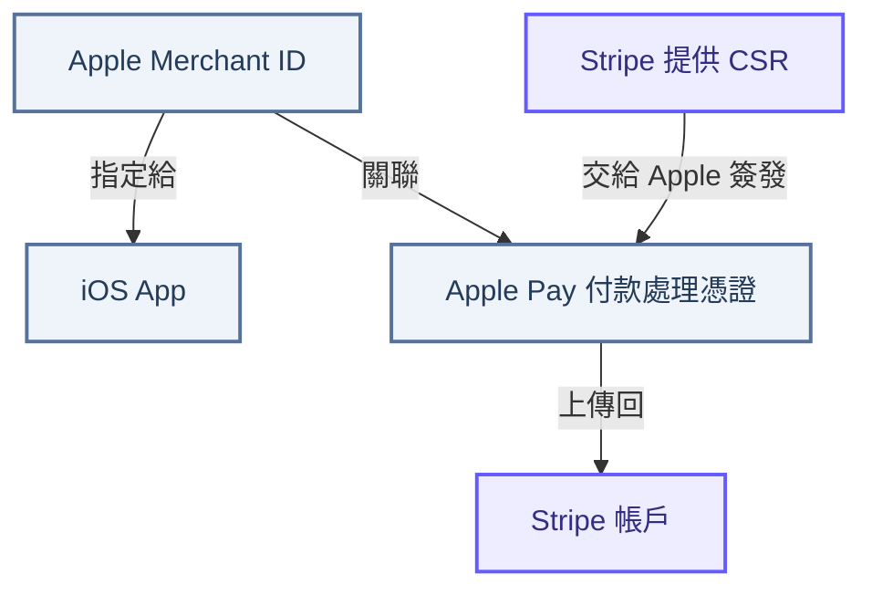
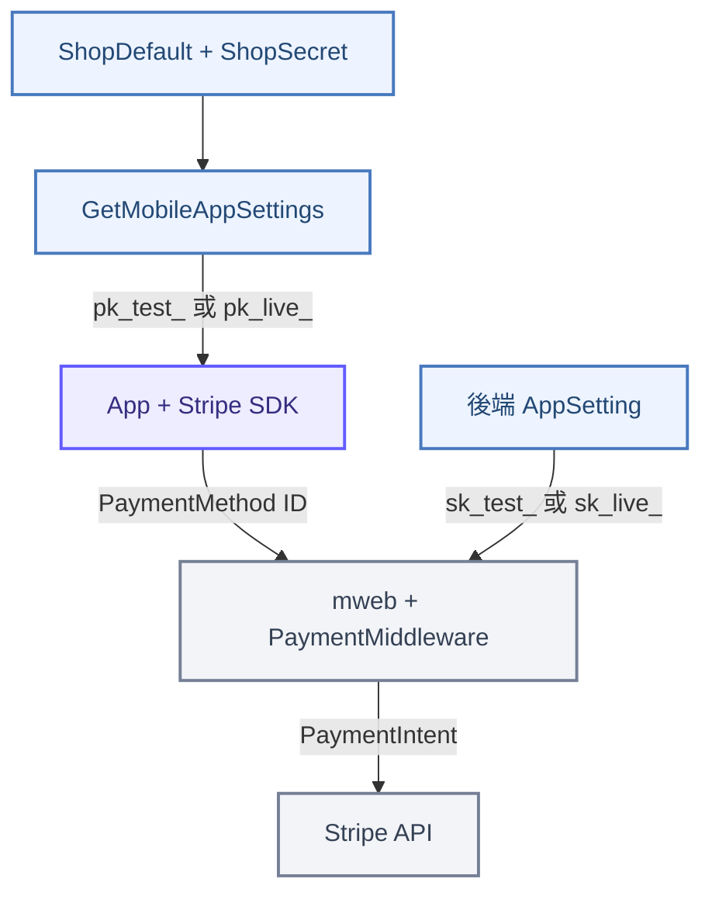
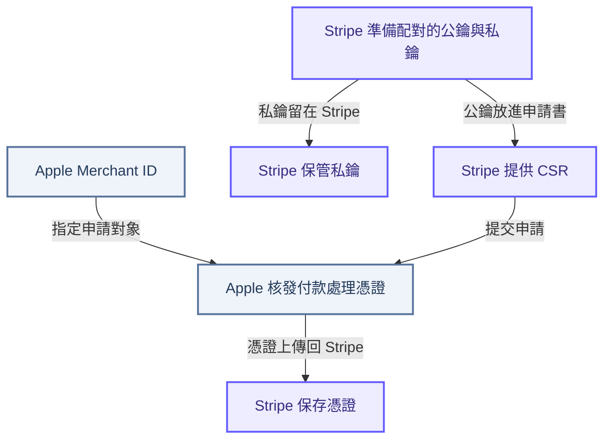



<!-- tab 全貌 -->

Stripe × Apple Pay · Architecture

一筆 Apple Pay 付款，背後有兩條先接好的關係

Apple 要知道這個 App 代表哪個商家收款，Stripe 要能處理 Apple Pay 加密後的付款資料。真正付款時，App 與後端還要使用對應的 Stripe 帳戶和模式。

## 第一章：先看全貌

上線前，確認商家身分與付款資料的處理者

<code>Apple Merchant ID</code> 是商家在 Apple Pay 的身分。iOS App 將它設定在 Apple Pay capability，表示這個 App 代表該商家收款。Stripe 提供 <code>CSR</code>，Apple 根據 CSR 為該 Merchant ID 簽發付款處理憑證，最後把憑證放回 Stripe。

這張圖描述上線前的設定關係。Apple 用憑證中的公鑰加密付款資料，Stripe 持有相對應的私鑰，才能解密並處理。憑證不是 App 的 API key。

付款時，App 與後端各使用一把 Stripe key

App 呼叫 <code>GetMobileAppSettings</code>，取得從 <code>ShopDefault</code> 與 <code>ShopSecret</code> 選出的 publishable key，再初始化 Stripe SDK。使用者完成 Apple Pay 操作後，App 把 <code>PaymentMethod ID</code> 交給 mweb。後端用自己的 secret key，透過 PaymentMiddleware 向 Stripe 建立付款。

這張圖只呈現關鍵交接。原生 App 建立 PaymentMethod 的 SDK callback 尚未在本次查閱的程式庫中確認；mweb 接收 <code>paymentMethodId</code>、傳給 PaymentMiddleware 的介面已有程式碼可追。

三種名稱相近，但工作不同的東西

<strong>Apple Merchant ID</strong>
回答「哪個商家在收款」。App 使用這個 ID 啟用 Apple Pay；同一個 Merchant ID 可以供多個 App 使用。

<strong>憑證中的公鑰</strong>
回答「Apple Pay 付款資料要用什麼加密」。Apple 加密後，由持有對應私鑰的 Stripe 處理。

<strong>Stripe publishable key</strong>
回答「App 的 Stripe SDK 使用哪個帳戶與模式」。格式是 <code>pk_test_</code> 或 <code>pk_live_</code>，並不是憑證中的公鑰。

<strong>讀圖重點：</strong><code>Merchant ID + 付款處理憑證</code>建立 Apple Pay 的商家與加密關係；<code>pk_*</code> 和 <code>sk_*</code> 則分別供 App 與後端使用 Stripe API。兩組設定都要對上，Apple Pay 付款才能走完整條鏈路。

資料依據：[Apple Pay 設定](https://developer.apple.com/help/account/capabilities/configure-apple-pay)、[Stripe iOS 憑證設定](https://docs.stripe.com/payments/mobile/accept-payment?platform=ios&type=setup)、[Stripe API keys](https://docs.stripe.com/keys)。專案內的設定及傳遞路徑，見原始分析文件的 `GetMobileAppSettings` 與付款鏈路章節。

<!-- endtab -->

<!-- tab CSR -->

## 第二章：Stripe CSR 是什麼

Apple Pay 付款資料會先被加密，再交給 Stripe 處理。要讓 Stripe 能解開這份資料，上線前得先備好一組對得上的公鑰與私鑰。Stripe 保管私鑰，並提供一份含有對應公鑰的申請文件，交給 Apple 核發憑證。這份申請文件就是 <code>CSR</code>。

CSR 是申請書，不是付款時使用的憑證

<code>CSR</code> 的全名是 Certificate Signing Request，中文是「憑證簽署請求」。它把要放進憑證的公鑰資料交給 Apple。Apple 收到後，針對指定的 <code>Apple Merchant ID</code> 核發付款處理憑證。<code>CSR</code> 本身還沒有經過 Apple 簽發，不能拿來取代憑證，也不包含用來解密的私鑰。

圖中的兩條線最後要接到同一組鑰匙：Apple Pay 使用憑證中的公鑰加密付款資料，Stripe 使用自己保管的對應私鑰解密。CSR 與憑證的申請是在上線前完成，不會在每筆付款時重做。

為什麼要從 Stripe 取得 CSR

這條付款鏈路由 Stripe 處理加密後的 Apple Pay 資料，所以憑證中的公鑰必須對應 Stripe 能使用的私鑰。若改用自行產生的另一份 CSR，Apple 核發的憑證就會對應另一組鑰匙，不能假設 Stripe 能解開用它加密的付款資料。Apple 也明確建議使用付款服務商時，向服務商取得適用的 CSR。

實際取得與提交順序

1. 在 Apple Developer 確認 App 使用的 <code>Apple Merchant ID</code>。
2. 登入要處理這筆 Apple Pay 交易的 Stripe 帳戶，開啟 [iOS Certificate Settings](https://dashboard.stripe.com/settings/ios_certificates)，選擇 <code>Add new application</code>，依畫面指示下載 Stripe 提供的 <code>CSR</code>。
3. 回到 Apple Developer，選擇該 Merchant ID，建立 <code>Apple Pay Payment Processing Certificate</code>，提交剛下載的 CSR。
4. 下載 Apple 核發的憑證，依 Stripe Dashboard 指示上傳回對應的 Stripe 帳戶。

<strong>更換時要記住：</strong>一份 Stripe CSR 只能用來核發一張憑證。更換 Merchant ID 或更新憑證時，應重新從 Stripe 取得 CSR，不沿用舊檔。

<code>CSR</code> 處理的是「Apple Pay 憑證要使用哪組公私鑰」。App 初始化 Stripe SDK 所用的 <code>pk_test_</code> 或 <code>pk_live_</code> 是另一種金鑰，不會放進這份 CSR，也不能拿來當憑證公鑰。

資料依據：[Stripe iOS Apple Pay 設定](https://docs.stripe.com/payments/mobile/accept-payment?platform=ios&type=setup)、[Apple 的付款服務商 CSR 說明](https://developer.apple.com/help/account/certificates/create-a-certificate-signing-request)、[Apple Pay 公私鑰用途](https://developer.apple.com/documentation/xcode/configuring-apple-pay-support)、[Stripe 憑證更新建議](https://docs.stripe.com/apple-pay/best-practices)。

<!-- endtab -->


