

<!-- tab 全貌 -->

<style>
.sap-hero{background:linear-gradient(135deg,#352b80 0%,#635bff 74%,#827cff 100%);color:#fff;border-radius:18px;padding:32px 34px;margin:0 0 26px;box-shadow:0 14px 30px rgba(71,62,155,.18)}
.sap-hero .sap-eyebrow{font-size:.78rem;font-weight:800;letter-spacing:.16em;text-transform:uppercase;opacity:.82}
.sap-hero .sap-title{color:#fff;font-size:1.65rem;font-weight:800;line-height:1.35;margin:12px 0 10px}
.sap-hero p{color:#fff;line-height:1.85;margin:0;max-width:760px;opacity:.96}
.sap-section{margin:34px 0 12px;padding:0 0 0 14px;border-left:4px solid #635bff;color:#292746;font-size:1.2rem;font-weight:800}
.sap-lead{color:#4d5266;line-height:1.9;margin:0 0 18px}
.sap-diagram{border:1px solid #e4e7f2;border-radius:16px;background:#fbfcff;padding:14px 18px;margin:14px 0 22px;overflow-x:auto}
.sap-key-diagram svg{min-width:360px}
.sap-caption{font-size:.87rem;color:#667085;line-height:1.7;margin:-10px 0 22px}
.sap-roles{display:grid;grid-template-columns:1fr;gap:10px;margin:18px 0 20px}
.sap-role{background:#fff;border:1px solid #e5e7f2;border-left:4px solid #635bff;border-radius:11px;padding:15px 19px;box-shadow:0 4px 12px rgba(34,38,75,.04)}
.sap-role:nth-child(2){border-left-color:#4879be}
.sap-role:nth-child(3){border-left-color:#758096}
.sap-role strong{display:block;color:#252746;font-size:.98rem;margin-bottom:7px}
.sap-role p{color:#575d6e;font-size:.9rem;line-height:1.8;margin:0}
.sap-lead code,.sap-caption code,.sap-role code,.sap-note code{background:#eeecff!important;color:#4239a1!important;border-radius:4px;padding:1px 5px}
.sap-note{background:#f1f0ff;border-left:4px solid #635bff;border-radius:0 11px 11px 0;padding:16px 19px;color:#353263;line-height:1.85;margin:20px 0}
.sap-note strong{color:#29236d}
[data-theme=dark] .sap-section{color:#e9e8ff}
[data-theme=dark] .sap-lead,[data-theme=dark] .sap-caption{color:#cbd2e0}
[data-theme=dark] .sap-diagram{background:#202431;border-color:#414862}
@media(max-width:760px){.sap-hero{padding:25px 23px}.sap-hero .sap-title{font-size:1.35rem}.sap-diagram{padding:10px}}
@media(max-width:760px){ #stripe_applepay-5 table{min-width:580px}#stripe_applepay-5 th:first-child,#stripe_applepay-5 td:first-child{white-space:nowrap}}
.sap-payment-sequence svg{min-width:660px}
#stripe_applepay-6 table{table-layout:fixed;width:100%}
#stripe_applepay-6 td code{white-space:normal;overflow-wrap:anywhere}
@media(max-width:760px){ #stripe_applepay-6 table{min-width:580px}}
</style>

<div class="sap-hero">
<div class="sap-eyebrow">Stripe × Apple Pay · Architecture</div>
<div class="sap-title">一筆 Apple Pay 付款，背後有兩條先接好的關係</div>
<p>Apple 要知道這個 App 代表哪個商家收款，Stripe 要能處理 Apple Pay 加密後的付款資料。真正付款時，App 與後端還要使用對應的 Stripe 帳戶和模式。</p>
</div>

## 第一章：先看全貌

<div class="sap-section">上線前，確認商家身分與付款資料的處理者</div>

<p class="sap-lead"><code>Apple Merchant ID</code> 是商家在 Apple Pay 的身分。iOS App 將它設定在 Apple Pay capability，表示這個 App 代表該商家收款。Stripe 提供 <code>CSR</code>，Apple 根據 CSR 為該 Merchant ID 簽發付款處理憑證，最後把憑證放回 Stripe。</p>

<div class="sap-diagram">

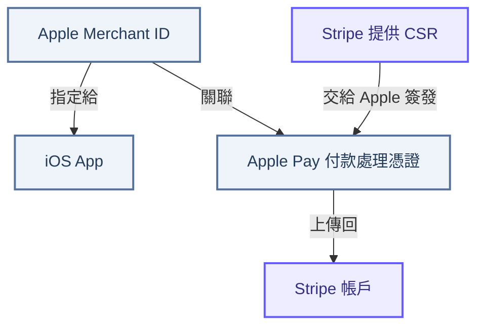

</div>

<p class="sap-caption">這張圖描述上線前的設定關係。Apple 用憑證中的公鑰加密付款資料，Stripe 持有相對應的私鑰，才能解密並處理。憑證不是 App 的 API key。</p>

<div class="sap-section">付款時，App 與後端各使用一把 Stripe key</div>

<p class="sap-lead">App 呼叫 <code>GetMobileAppSettings</code>，取得從 <code>ShopDefault</code> 與 <code>ShopSecret</code> 選出的 publishable key，再初始化 Stripe SDK。使用者完成 Apple Pay 操作後，App 把 <code>PaymentMethod ID</code> 交給 mweb。後端用自己的 secret key，透過 PaymentMiddleware 向 Stripe 建立付款。</p>

<div class="sap-diagram">

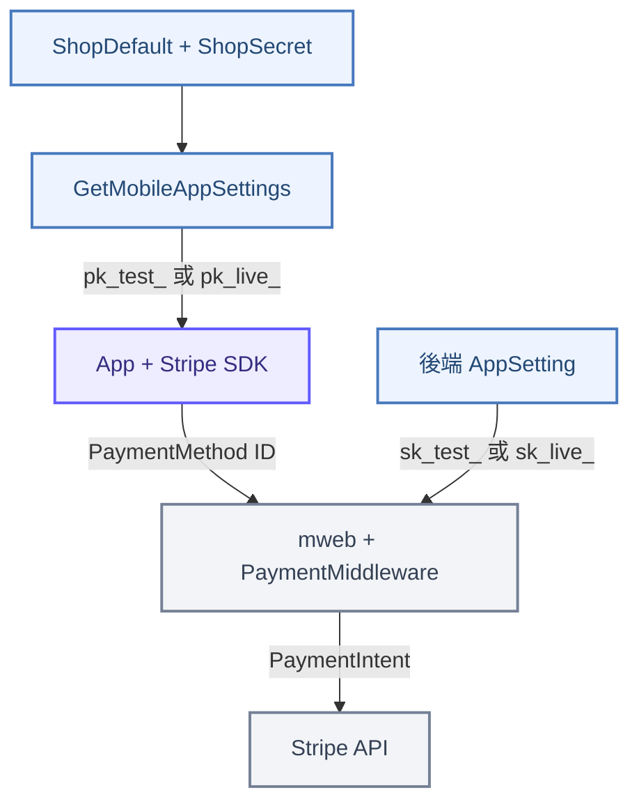

</div>


<div class="sap-section">三種名稱相近，但工作不同的東西</div>

<div class="sap-roles">
<div class="sap-role"><strong>Apple Merchant ID</strong><p>回答「哪個商家在收款」。App 使用這個 ID 啟用 Apple Pay；同一個 Merchant ID 可以供多個 App 使用。</p></div>
<div class="sap-role"><strong>憑證中的公鑰</strong><p>回答「Apple Pay 付款資料要用什麼加密」。Apple 加密後，由持有對應私鑰的 Stripe 處理。</p></div>
<div class="sap-role"><strong>Stripe publishable key</strong><p>回答「App 的 Stripe SDK 使用哪個帳戶與模式」。格式是 <code>pk_test_</code> 或 <code>pk_live_</code>，並不是憑證中的公鑰。</p></div>
</div>

<div class="sap-note"><code>Merchant ID + 付款處理憑證</code>建立 Apple Pay 的商家與加密關係；<code>pk_*</code> 和 <code>sk_*</code> 則分別供 App 與後端使用 Stripe API。兩組設定都要對上，Apple Pay 付款才能走完整條鏈路。</div>


<!-- endtab -->

<!-- tab CSR -->

## 第二章：Stripe CSR 是什麼

<p class="sap-lead">Apple Pay 付款資料會先被加密，再交給 Stripe 處理。要讓 Stripe 能解開這份資料，上線前得先備好一組對得上的公鑰與私鑰。Stripe 保管私鑰，並提供一份含有對應公鑰的申請文件，交給 Apple 核發憑證。這份申請文件就是 <code>CSR</code>。</p>

<div class="sap-section">CSR 是申請書，不是付款時使用的憑證</div>

<p class="sap-lead"><code>CSR</code> 的全名是 Certificate Signing Request，中文是「憑證簽署請求」。它把要放進憑證的公鑰資料交給 Apple。Apple 收到後，針對指定的 <code>Apple Merchant ID</code> 核發付款處理憑證。<code>CSR</code> 本身還沒有經過 Apple 簽發，不能拿來取代憑證，也不包含用來解密的私鑰。</p>

<div class="sap-diagram">

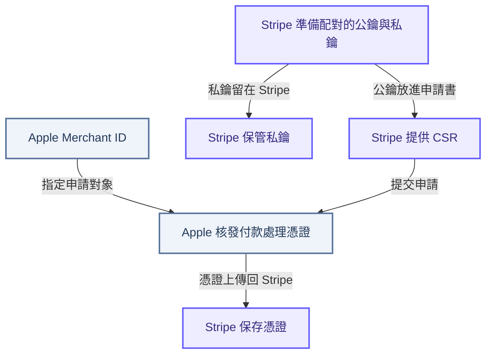

</div>

<p class="sap-caption">圖中的兩條線最後要接到同一組鑰匙：Apple Pay 使用憑證中的公鑰加密付款資料，Stripe 使用自己保管的對應私鑰解密。CSR 與憑證的申請是在上線前完成，不會在每筆付款時重做。</p>

<div class="sap-section">為什麼要從 Stripe 取得 CSR</div>

<p class="sap-lead">這條付款鏈路由 Stripe 處理加密後的 Apple Pay 資料，所以憑證中的公鑰必須對應 Stripe 能使用的私鑰。若改用自行產生的另一份 CSR，Apple 核發的憑證就會對應另一組鑰匙，不能假設 Stripe 能解開用它加密的付款資料。Apple 也明確建議使用付款服務商時，向服務商取得適用的 CSR。</p>

<div class="sap-section">實際取得與提交順序</div>

1. 在 Apple Developer 確認 App 使用的 <code>Apple Merchant ID</code>。
2. 登入要處理這筆 Apple Pay 交易的 Stripe 帳戶，開啟 [iOS Certificate Settings](https://dashboard.stripe.com/settings/ios_certificates)，選擇 <code>Add new application</code>，依畫面指示下載 Stripe 提供的 <code>CSR</code>。
3. 回到 Apple Developer，選擇該 Merchant ID，建立 <code>Apple Pay Payment Processing Certificate</code>，提交剛下載的 CSR。
4. 下載 Apple 核發的憑證，依 Stripe Dashboard 指示上傳回對應的 Stripe 帳戶。


<p class="sap-lead"><code>CSR</code> 處理的是「Apple Pay 憑證要使用哪組公私鑰」。App 初始化 Stripe SDK 所用的 <code>pk_test_</code> 或 <code>pk_live_</code> 是另一種金鑰，不會放進這份 CSR，也不能拿來當憑證公鑰。</p>


<!-- endtab -->

<!-- tab 憑證 -->

## 第三章：Apple Pay 憑證的意義與產生方式

<p class="sap-lead">Apple 核發憑證後，還需要讓 App 的商家設定與 Stripe 的憑證設定對上，付款資料才有對應的處理者。這一章接著看核發後的檔案、設定完成的條件，以及到期前的更新方式。</p>

<div class="sap-section">Apple 核發的是付款處理憑證</div>

<p class="sap-lead">本文的 iOS App 整合使用 <code>Apple Pay Payment Processing Certificate</code>。Apple 將它關聯到指定的 <code>Merchant ID</code>，憑證中的公鑰用來加密付款資料。在這條 Stripe 整合中，對應私鑰由 Stripe 保管，下載憑證不會取得那把私鑰。</p>

| 項目 | 負責的事情 |
| --- | --- |
| Apple Pay Payment Processing Certificate | 提供 Apple Pay 付款資料加密所需的公鑰 |
| App 簽章憑證 | 簽署 App，與付款資料的加密用途不同 |
| Apple Pay Merchant Identity Certificate | Apple Pay on the Web 與 Apple 建立商家驗證連線時使用 |
| Stripe API keys | App 與後端存取 Stripe API 時使用，詳見第一章的金鑰分工 |

付款處理憑證與 Merchant ID 的關係見 [Apple 設定說明](https://developer.apple.com/help/account/capabilities/configure-apple-pay)；Web 商家驗證憑證的用途見 [Apple Pay on the Web](https://developer.apple.com/help/account/capabilities/configure-apple-pay-on-the-web)。

<div class="sap-section">提交 CSR 後，取得什麼檔案</div>

<p class="sap-lead">沿用第二章選定的 <code>Merchant ID</code> 與 Stripe CSR，Apple 核發後取得的是 <code>.cer</code> 檔案。這份檔案接著交回提供 CSR 的 Stripe 帳戶。</p>

<div class="sap-diagram">

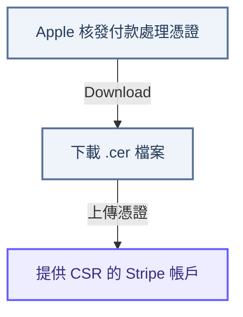

</div>

<div class="sap-note"><strong>下載完成與設定完成是兩個階段。</strong>電腦上已有 <code>.cer</code>，只表示已取得 Apple 核發的檔案；Stripe 端仍須完成上傳，才能接上這次憑證設定。</div>

<div class="sap-section">完成設定，要核對三個位置</div>

| 位置 | 核對內容 |
| --- | --- |
| iOS App | Apple Pay capability 勾選的 Merchant ID，與付款請求使用的商家識別一致 |
| Apple Developer | 憑證建立在該 Merchant ID 下，且仍在有效期間內 |
| Stripe Dashboard | Apple 核發的憑證已上傳到提供 CSR、預定處理付款的帳戶 |

<p class="sap-lead">這三處核對的是同一條商家與憑證關係。完成後，仍要以測試金鑰執行 Apple Pay 付款，確認整合能處理付款資料。憑證有效不代表交易成功，也不決定交易使用 Test 或 Live 模式。</p>

<div class="sap-section">到期前更新，先讓 Stripe 準備好</div>

<p class="sap-lead">付款處理憑證的有效期為 <strong>25 個月</strong>，應在到期前完成更新。更新的重點是避免 Apple 已改用新公鑰加密，Stripe 卻還沒收到新憑證。</p>

<div class="sap-diagram">

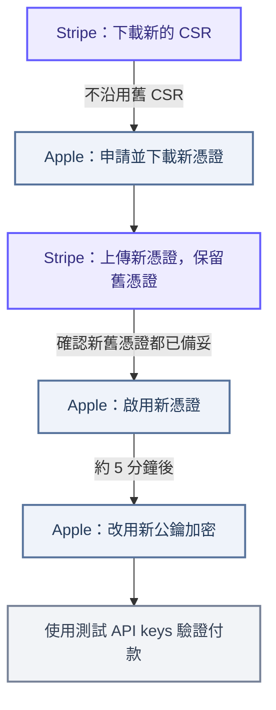

</div>

<p class="sap-caption">由上往下依序完成更新。先上傳 Stripe，再到 Apple 啟用；切換期間保留新舊憑證，讓兩張憑證都可使用。單純更換憑證不需要更新 App。</p>

有效期依據 [Apple 付款處理憑證說明](https://developer.apple.com/help/account/capabilities/configure-apple-pay)；切換順序與驗證方式依據 [Stripe 憑證更新建議](https://docs.stripe.com/apple-pay/best-practices#apple-pay-certificate-renewal)。

<!-- endtab -->

<!-- tab App 金鑰 -->

## 第四章：App 的 Publishable Key 從哪裡來

<p class="sap-lead">憑證設定完成後，App 還要取得 Stripe SDK 使用的公開金鑰。以下以目前香港站的實作為例，從設定 API 一路追到商店的金鑰來源。</p>

<div class="sap-section">App 透過設定 API 取得金鑰</div>

<div class="sap-diagram sap-key-diagram">

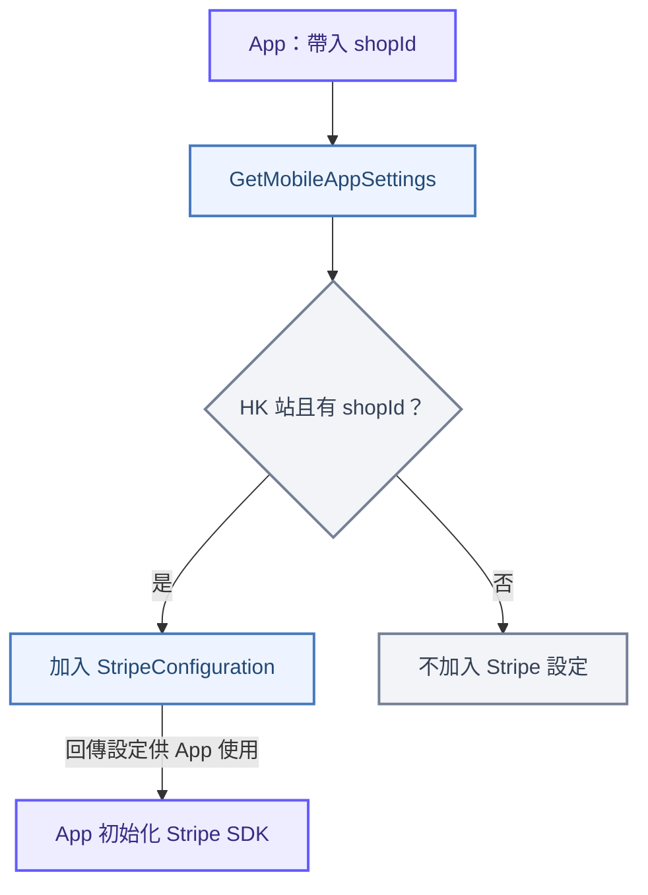

</div>

<p class="sap-caption">圖中是設定取得與使用的關係。後端程式碼已確認回傳欄位與加入條件；原生 App 的 SDK 初始化細節不在本次查閱範圍內。</p>

<div class="sap-section">API 回傳什麼</div>

請求路徑：`GET /webapi/APPNotification/GetMobileAppSettings/{shopId}`。下方節錄 `Data.ExtendInfo.StripeConfiguration`，金鑰為示意值。

```json
{
  "PublishableKey": "pk_test_...",
  "MerchantName": "商店名稱",
  "MerchantCountryCode": "HK",
  "Mode": "Test"
}
```

| 欄位 | 內容與來源 |
| --- | --- |
| `PublishableKey` | 從 `ShopSecret` 取得的 Stripe 公開金鑰 |
| `MerchantName` | 商店名稱，與 Apple 的 `Merchant ID` 不同 |
| `MerchantCountryCode` | `ShopStaticSetting` 的 `Stripe / CountryCode`；查不到時使用 `HK` |
| `Mode` | 由 key 前綴判斷的模式；無法辨識時使用預設設定 |

<div class="sap-section">先取得帳戶類型，再決定查哪一把 key</div>

<div class="sap-diagram sap-key-diagram">

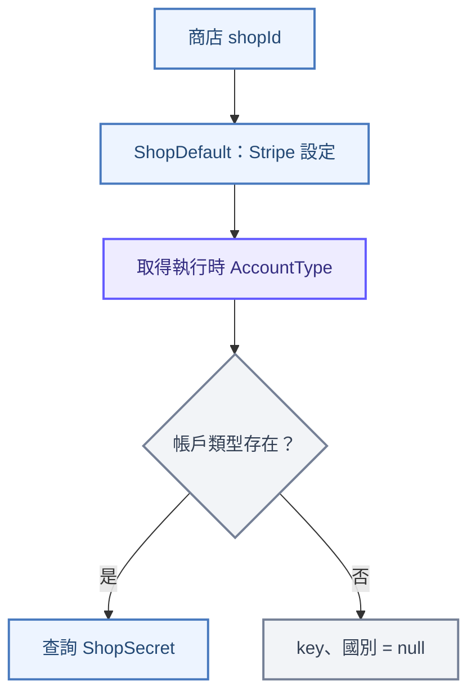

</div>

<p class="sap-caption"><code>AccountType</code> 指執行時取得的 <code>StripeAccountType</code>。它可能受 <code>EnableCustomDate</code> 影響，不能直接把 DB 原值當成最終查詢類型。</p>

<div class="sap-section">ShopSecret 的查詢範圍如何選</div>

<p class="sap-lead">查詢群組固定為 <code>Stripe</code>，設定鍵是 <code>{AccountType}PublishableKey</code>。另外還要依帳戶類型，決定查商店自己的設定，或 <code>ShopId = 0</code> 的共用設定。</p>

<div class="sap-diagram sap-key-diagram">

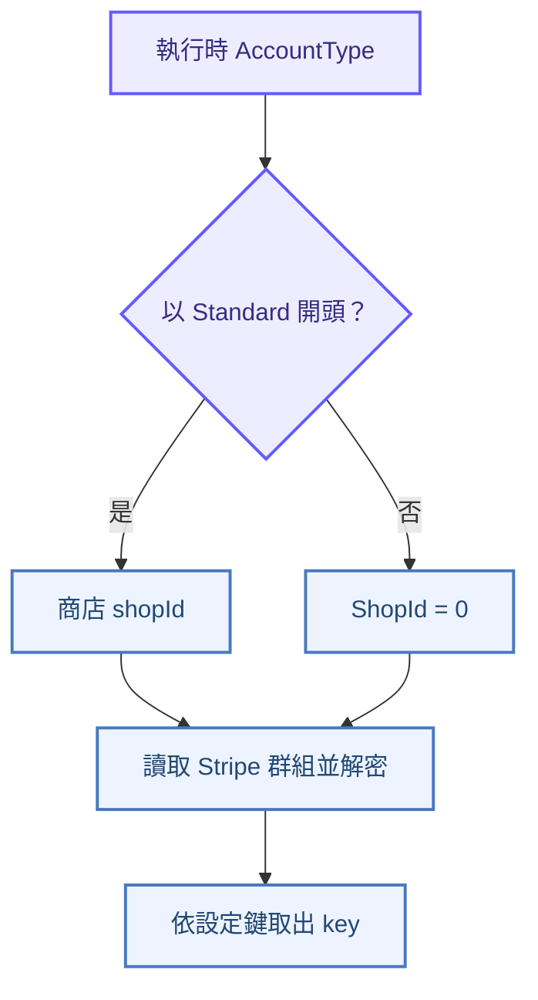

</div>

| 執行時類型範例 | 查詢 ShopId | 設定鍵 |
| --- | --- | --- |
| `Standard` | 商店 shopId | `StandardPublishableKey` |
| `CustomTest` | `0` | `CustomTestPublishableKey` |

<p class="sap-caption">表格假設帳戶類型已完成執行時轉換。服務可能從快取取得資料；找不到對應設定鍵時，<code>PublishableKey</code> 會是 <code>null</code>。</p>

<div class="sap-section">Mode 怎麼判定</div>

<p class="sap-lead"><code>GetStripeMode()</code> 依取得的 <code>PublishableKey</code> 判定模式。<code>AccountType</code> 決定選哪把 key，再由 key 前綴決定 <code>Mode</code>；不會直接用 QA 網域或帳戶類型名稱判定。</p>

<div class="sap-diagram sap-key-diagram">

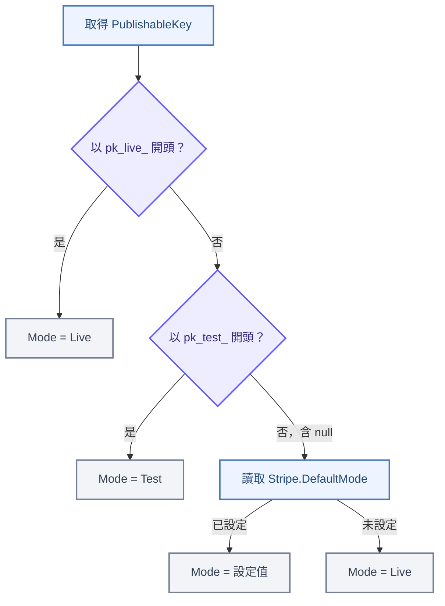

</div>

<p class="sap-caption">依程式順序先檢查 <code>pk_live_</code>，再檢查 <code>pk_test_</code>；兩者都不符合時才使用預設設定。前綴能辨識時，不會被 <code>Stripe.DefaultMode</code> 覆蓋。</p>

| 取得的 PublishableKey | Stripe.DefaultMode | 回傳 Mode |
| --- | --- | --- |
| `pk_test_...` | `Live` | `Test` |
| `pk_live_...` | `Test` | `Live` |
| `null` 或無法辨識的前綴 | `Test` | `Test` |
| `null` 或無法辨識的前綴 | 未設定 | `Live` |

<div class="sap-note"><strong>Mode 不能單獨證明付款設定有效。</strong>找不到 key 且未設定預設模式時，可能同時得到 <code>PublishableKey = null</code> 與 <code>Mode = Live</code>。另外，這裡回傳的是 App 設定中的模式；後端的 <code>sk_*</code> 另有選取流程，<code>Mode = Test</code> 不能單獨保證後端也使用測試金鑰。</div>

<details>
<summary>程式碼對照：設定入口與查詢方法</summary>

| 位置 | 核對的行為 |
| --- | --- |
| `APPNotificationController.GetMobileAppSettings` | 接收 shopId，呼叫設定服務並回傳 Data |
| `MobileAppSettingService.GetMobileAppSettings` | HK 與 shopId 條件、StripeConfiguration 欄位 |
| `MobileAppSettingService.GetStripeStaticSetting` | 帳戶類型空值、查詢鍵、ShopId 分支及國別預設值 |
| `MobileAppSettingService.GetStripeMode` | key 前綴與模式的預設值 |
| `ShopDefaultService.GetShopStripeSetting` | 讀取商店 Stripe 設定 |
| `StripeSettingsEntity.GetRuntimeAccountType` | 計算執行時帳戶類型 |

</details>

<!-- endtab -->

<!-- tab 帳戶與金鑰 -->

## 第五章：帳戶類型如何決定前後端金鑰

<p class="sap-lead">商店設定寫著 <code>CustomTest</code>，執行時卻可能使用 <code>Standard</code>。金鑰查詢前，程式會先判斷 Custom 的啟用時間；轉換後的帳戶類型，同時影響 App 與後端選用的設定。</p>

<div class="sap-section">先看執行時類型，不能只看 DB 原值</div>

<p class="sap-lead"><code>StripeAccountType</code> 的 getter 會呼叫 <code>GetRuntimeAccountType()</code>。以下以專案定義的標準帳戶類型名稱說明轉換。</p>

<div class="sap-diagram sap-key-diagram">

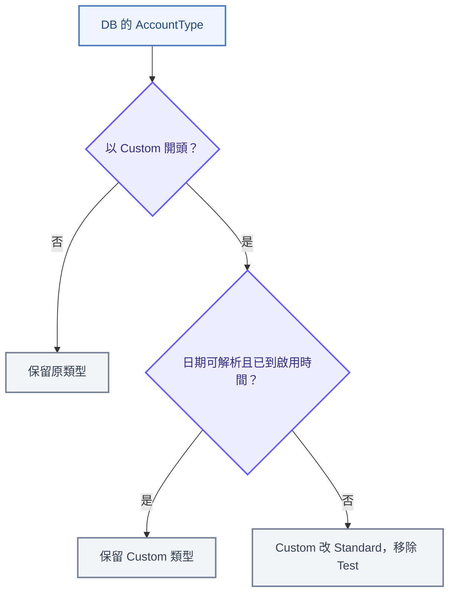

</div>

<p class="sap-caption">日期指 <code>EnableCustomDate</code>，以伺服器的 <code>DateTime.Now</code> 比較。未設定、無法解析或仍在未來，都會走轉換分支；等於目前時間時可保留 Custom。</p>

| DB 原值 | 啟用日期未到或無法解析 | 日期可解析且已到啟用時間 |
| --- | --- | --- |
| `Custom` | `Standard` | `Custom` |
| `CustomTest` | `Standard` | `CustomTest` |
| `CustomUAT` | `StandardUAT` | `CustomUAT` |
| `CustomUATTest` | `StandardUAT` | `CustomUATTest` |

<p class="sap-lead">同一個設定物件首次算出非空的執行時類型後，會保留該結果，避免後續讀取因跨過啟用時間而改變。這是物件內的結果保留，不代表整個服務永久固定使用該類型。</p>

<div class="sap-section">一個帳戶類型，分別選出兩邊的設定</div>

<div class="sap-diagram sap-key-diagram">

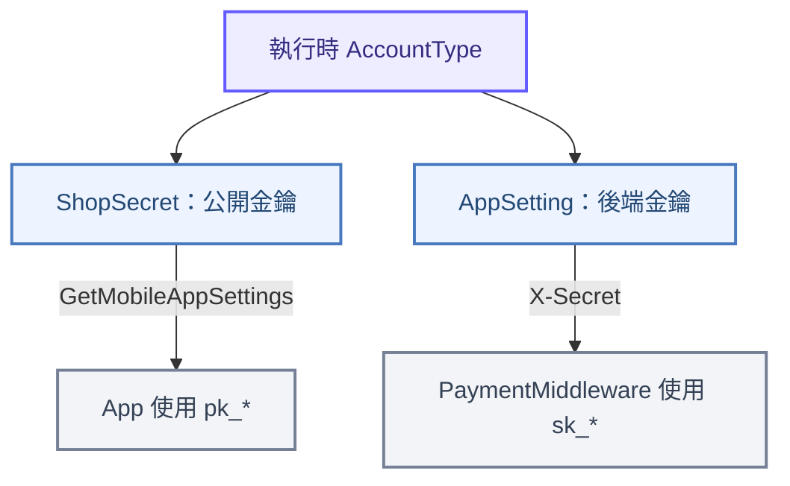

</div>

<p class="sap-caption">箭頭表示設定選擇與傳遞關係。App 與付款請求各自取得設定，並不是共用同一個設定物件。第四章的 <code>Mode</code> 由 <code>pk_*</code> 推得；後端依帳戶類型選取 <code>sk_*</code>。</p>

<div class="sap-section">後端 secret key 對照</div>

<p class="sap-lead"><code>GetStripeApiKey()</code> 依執行時類型選取設定。下表的「設定尾碼」都接在 <code>Stripe.</code> 後面，例如 <code>Stripe.CustomAcct.SecretKeys.Test</code>。</p>

| 執行時 AccountType | AppSetting 設定尾碼 |
| --- | --- |
| `Standard` | `StandardAcct.SecretKeys.Live` |
| `StandardUAT` | `StandardUATAcct.SecretKeys.Live` |
| `Custom` | `CustomAcct.SecretKeys.Live` |
| `CustomTest` | `CustomAcct.SecretKeys.Test` |
| `CustomUAT` | `CustomUATAcct.SecretKeys.Live` |
| `CustomUATTest` | `CustomUATAcct.SecretKeys.Test` |
| 未匹配上述類型 | `StandardAcct.SecretKeys.Live` |

<div class="sap-section">Standard 類型還有舊設定退回路徑</div>

<div class="sap-diagram sap-key-diagram">

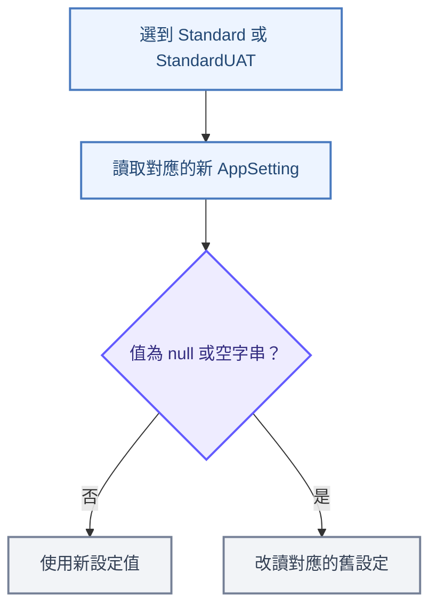

</div>

| 選到的設定組 | 新設定無值時讀取 |
| --- | --- |
| Standard | `Stripe.Private.Key` |
| StandardUAT | `Stripe.Test.Private.Key` |

<p class="sap-caption">未匹配的類型也會選到 Standard 設定組，沿用同一條退回路徑。此處程式只檢查 <code>null</code> 或空字串；Custom 各組則直接讀取對應設定，沒有這段舊設定退回邏輯。</p>

<div class="sap-section">以 CustomTest 尚未啟用為例</div>

| 核對位置 | 實際選擇 |
| --- | --- |
| DB 原值 | `CustomTest` |
| 執行時結果 | `Standard` |
| App 公開金鑰 | 商店 ShopId 下的 `StandardPublishableKey` |
| 後端金鑰 | `Stripe.StandardAcct.SecretKeys.Live`，無值時讀 `Stripe.Private.Key` |
| 實際模式 | 分別核對取出的 `pk_*`、`sk_*` 前綴 |

<div class="sap-note"><strong>設定名稱不能代替實際值。</strong><code>UAT</code>、<code>Test</code>、<code>Live</code> 出現在帳戶類型或設定名稱中，不足以單獨確認付款模式。應核對實際 key 前綴與 Stripe 帳戶設定，並確認 App 和後端使用相符的付款帳戶脈絡。</div>

<details>
<summary>程式碼對照：帳戶轉換與後端金鑰</summary>

| 位置 | 核對的行為 |
| --- | --- |
| `StripeSettingsEntity.GetRuntimeAccountType` | Custom 啟用日期、類型轉換與物件內結果保留 |
| `StripePayChannelService.GetStripeApiKey` | 六種帳戶類型及 default 分支 |
| `AppSettingsConfigurations` | AppSetting 名稱與 Standard 舊設定退回路徑 |
| `StripePayChannelService` 的付款標頭設定 | 將選出的 key 放入 `X-Secret` |

</details>

<div class="sap-section">設計建議：把目前設定與切換計畫分開</div>

<p class="sap-lead">以下是改善方案，尚非現行實作。現況將「準備啟用的帳戶」與「目前使用的帳戶」放在同一個 <code>AccountType</code>，再由日期推回實際類型。可改成明確保存目前與目標設定，讓 DB 與實際付款行為更容易核對。</p>

<p class="sap-lead"><strong>資料如何保存，與何時觸發切換，是兩個獨立的設計。</strong>切換前後的設定可以同時存在；人工按鈕與預約排程則共用同一個啟用流程，不需要操作人員直接修改 DB。</p>

| 設計項目 | 建議保存的內容 |
| --- | --- |
| 目前設定版本 | `standard-test-v1`：Standard／Test，對應帳戶與金鑰參照 |
| 目標設定版本 | `custom-test-v2`：Custom／Test，對應帳戶與金鑰參照 |
| 觸發方式 | 後台「立即啟用」，或預約時間由排程執行 |
| 切換紀錄 | 來源與目標版本、預定與實際時間、操作者或排程、執行結果 |

<p class="sap-caption">版本名稱為示例。每組設定將 <code>AccountType</code> 與 <code>StripeMode</code> 分開保存；切換帳戶時不再透過移除 <code>Test</code> 改變模式。金鑰以受控儲存中的參照關聯，後端 secret key 不回傳 App。</p>

<div class="sap-section">兩種觸發方式，共用一次完整切換</div>

<div class="sap-diagram sap-key-diagram">

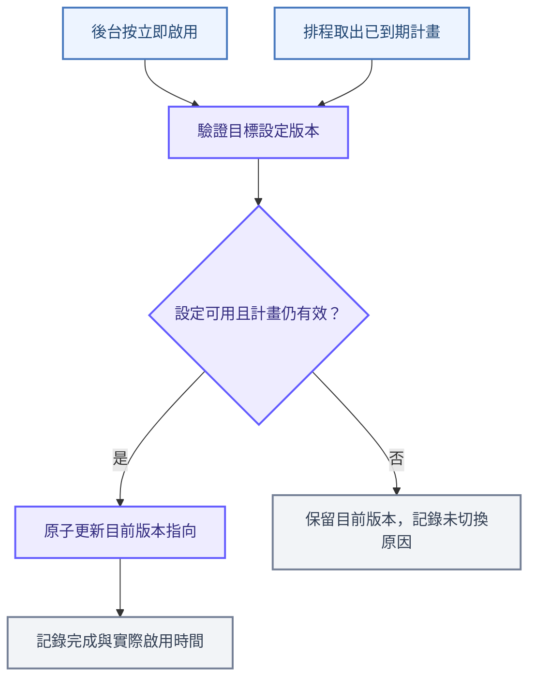

</div>

<p class="sap-caption">先準備完整的目標版本，啟用時只更新「目前使用哪一版」，避免逐欄修改造成新舊設定混用。驗證失敗應記錄原因並通知維運；排程可能延遲，預定時間與實際啟用時間需分開記錄。</p>

<details>
<summary>切換時還要維持的三個一致性條件</summary>

- **同一個計畫只生效一次**：按鈕與排程同時觸發時，以交易與版本條件檢查，確保只有一方完成切換；重試不可覆蓋後續的新計畫。
- **付款綁定設定版本**：建立付款工作階段時由後端綁定版本，App 取得該版本的公開設定，後端也沿用該版本處理付款。不能只在收到付款時才記錄版本，否則 App 可能已使用切換前的金鑰。
- **舊版本保留供既有交易使用**：新的付款使用新版本；既有付款的查詢、退款與後續處理保留原帳戶脈絡。版本保存與金鑰輪替分開管理，遇到金鑰撤銷時需有明確處理方式。

</details>

<p class="sap-lead">若希望維持「讀取時依時間選擇」而不由排程更新 DB，也可明確保存切換前版本、切換後版本與生效時間。這是另一種啟用機制，同樣需要付款版本綁定；不宜同時讓排程更新與讀取時計算各自決定目前版本。</p>

<!-- endtab -->

<!-- tab 付款鏈路 -->

## 第六章：一筆 Apple Pay 付款如何走到 Stripe

<p class="sap-lead">使用者在 Apple Pay 畫面完成授權後，付款還要接著走過結帳後端與 Stripe。本章沿著 <code>PaymentMethod ID</code>、<code>PaymentIntent</code> 與 <code>client_secret</code> 三個資料交接點，拆開看付款如何送出、回傳及確認結果。</p>

<p class="sap-caption">範圍是香港站 iOS App、mweb 與 PaymentMiddleware 的 Stripe Apple Pay 分支。原生 App 未納入本次程式碼查閱；SDK 的內部呼叫不畫成已確認的專案實作。第五章末的版本切換仍屬設計建議，本章描述現有程式。</p>

<div class="sap-section">先取得付款方式，再送出結帳</div>

<p class="sap-lead">Merchant ID 用於 Apple Pay 付款請求，publishable key 用於 Stripe SDK。依 Stripe 官方整合流程，SDK 會建立 PaymentMethod，再由後端建立 PaymentIntent；本站已確認的交接點，是 App 回傳 <code>paymentMethodId</code> 給結帳頁。</p>

<p class="sap-caption">原生端概念參考 <a href="https://docs.stripe.com/apple-pay?platform=ios#handle-payment">Stripe：iOS Apple Pay</a>，不代表本站使用特定 SDK 版本或完全相同的 delegate 寫法。</p>

<div class="sap-diagram sap-payment-sequence">

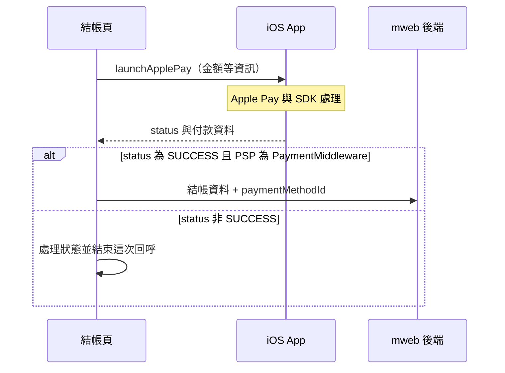

</div>

<p class="sap-caption">這裡的 <code>SUCCESS</code> 是 App 回呼狀態，只讓結帳流程繼續。非成功回呼會先處理狀態再返回；TapPay 等其他 PSP 的分支不在本章範圍。</p>

| 交接位置 | 傳遞的資料 | 代表什麼 |
| --- | --- | --- |
| App → 結帳頁 | `paymentMethodId` | 這次使用的付款方式識別碼 |
| 結帳頁 → 後端 | `paymentMiddlewareCreditCardInfo.extendInfo.paymentMethodId` | 放入結帳請求；此分支卡號、有效期與 CVV 欄位為空字串 |
| mweb → PMW | `ExtendInfo.payment_method` | 後端付款服務從付款上下文取出，交給 Stripe 插件使用 |

<div class="sap-section">後端使用這個付款方式建立 PaymentIntent</div>

<p class="sap-lead">mweb 組合付款方式、帳戶與費用資訊，並透過 <code>X-Secret</code> 傳送後端金鑰。PMW 的 <code>StripePlugin.Pay</code> 先辨識行動錢包，走 <code>ProcessMobileWalletPayment</code>，直接使用傳入的 PaymentMethod。</p>

<div class="sap-diagram sap-payment-sequence">

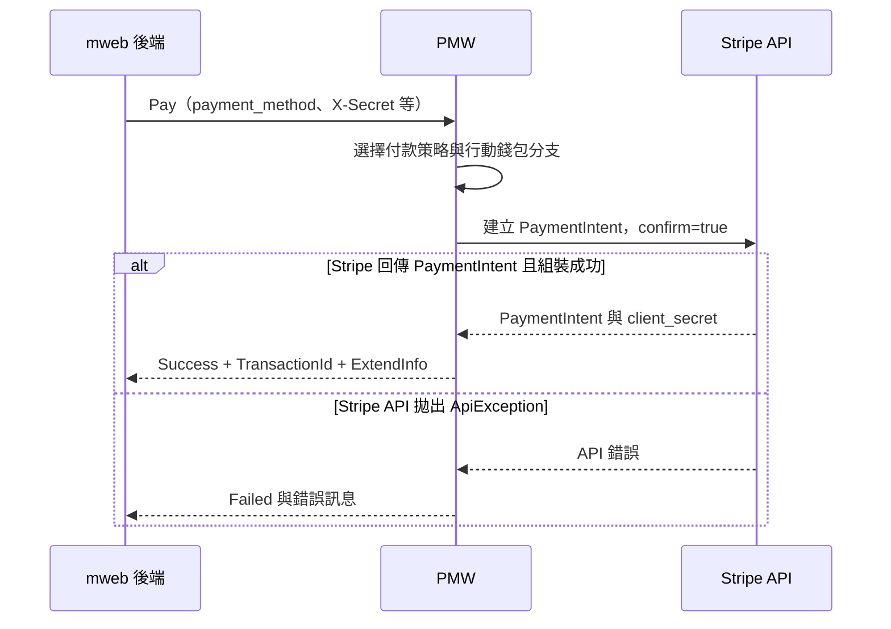

</div>

<p class="sap-caption">兩種付款策略都呼叫 <code>POST /v1/payment_intents</code>，帶入金額、幣別、<code>payment_method</code>、<code>confirmation_method=automatic</code> 與 <code>confirm=true</code>。其他未預期例外會記錄後拋出，並不都包成 <code>Failed</code>。<a href="https://docs.stripe.com/api/payment_intents/create">Stripe API：建立時可同時確認 PaymentIntent</a>。</p>

<details>
<summary>付款策略如何帶入商家帳戶</summary>

| 策略 | 商家帳戶的傳遞位置 |
| --- | --- |
| `DirectCharge` | 呼叫 Stripe 時帶入 `Stripe-Account` header |
| `DestinationCharge` | 請求內容帶入 `transfer_data[destination]` 與 `on_behalf_of` |

兩種策略都帶入 `application_fee_amount`。這是帳戶與款項流向的選擇，不能只看 `pk_*`、`sk_*` 的 Test／Live 前綴來取代帳戶脈絡核對。

</details>

<div class="sap-section">client_secret 沿原路交回 App</div>

<p class="sap-lead"><code>PaymentIntent</code> 的 ID 用來識別這筆付款；<code>client_secret</code> 則供客戶端處理這筆付款。它不是後端的 <code>sk_*</code>，也不應公開或寫入一般日誌。<a href="https://docs.stripe.com/api/payment_intents/object#payment_intent_object-client_secret">Stripe：client_secret 的用途與保護要求</a>。</p>

<div class="sap-diagram sap-payment-sequence">

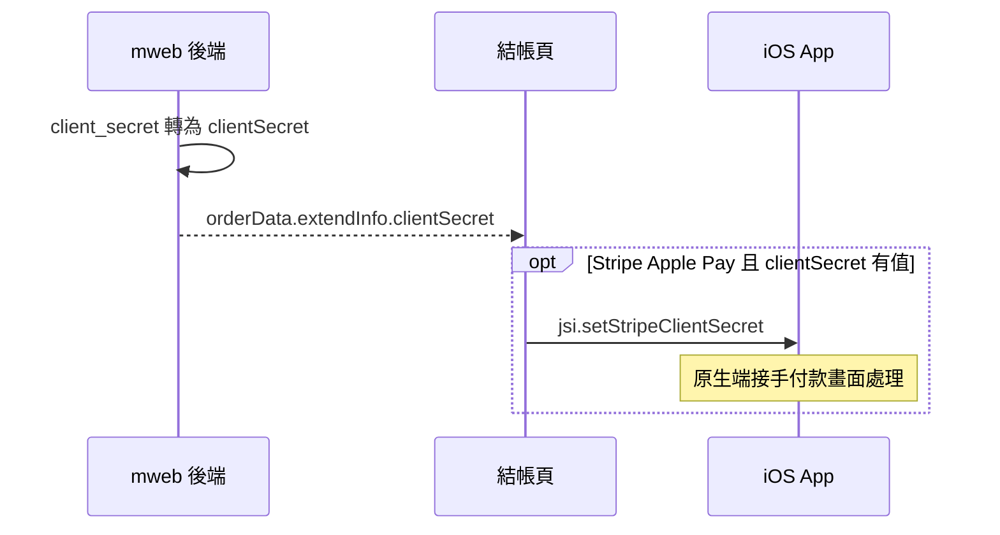

</div>

<p class="sap-caption">已確認的程式碼到 <code>jsi.setStripeClientSecret({ clientSecret })</code> 為止；App 如何交給 SDK、是否還需驗證及何時關閉畫面，需對照原生端實作，不能從這個呼叫直接認定付款完成。</p>

<div class="sap-section">三種成功訊號，要分開閱讀</div>

| 觀察到的訊號 | 可以確認 | 仍不能單獨證明 |
| --- | --- | --- |
| App 回呼 `SUCCESS` | 前端會繼續組合結帳資料 | Stripe 已付款成功 |
| PMW 建立付款回應 `Success` | 行動錢包分支已取得 PaymentIntent 並完成回應組裝 | PaymentIntent 的狀態必然為 `succeeded` |
| Stripe `status=succeeded` | Stripe 端這筆付款成功 | 商城訂單狀態已更新完成 |

<p class="sap-lead"><code>GetMobileWalletThirdPartyPayResponseEntity</code> 在組裝回應時直接填入 <code>ReturnCodes.Success</code>，沒有在該方法檢查 PaymentIntent 狀態。查詢付款的 <code>GetThirdPartyQueryPaymentDetail</code> 才依狀態轉換回傳結果。</p>

<details>
<summary>查詢付款時的狀態對照與後續邊界</summary>

| Stripe 狀態／條件 | 此版 PMW 查詢回應 |
| --- | --- |
| `succeeded` | `Success` |
| `requires_payment_method` 且有 `last_payment_error` | `Failed`，附錯誤資訊 |
| `requires_action`、`requires_confirmation`，或沒有付款錯誤的 `requires_payment_method` | `WaitingToPay` |
| 其他狀態 | `UnhandledException` |

這是目前查閱程式的映射，不是 Stripe 全部狀態的通用分類。商城訂單是否已完成付款，還需接著追蹤查詢結果如何寫入訂單，以及補查與通知機制；本章不將未核對的 webhook 或 worker 畫成既定流程。

</details>

<details>
<summary>程式碼對照：付款請求與結果回傳</summary>

| 程式位置 | 本章核對內容 |
| --- | --- |
| `CartClientApp/src/pages/checkout/index.tsx` | Apple Pay 回呼分支、`paymentMethodId` 放入結帳請求 |
| `StripePayChannelService.GetMobileWalletPayExtendInfo` | 取出 `payment_method`，加入付款策略、帳戶與費用資訊 |
| `StripePlugin.Pay` | 行動錢包分支、API 錯誤處理 |
| `DirectChargePaymentFlowStrategy.ProcessMobileWalletPayment` | 建立並確認 PaymentIntent、帶入子帳戶 header |
| `DestinationChargePaymentFlowStrategy.ProcessMobileWalletPayment` | 建立並確認 PaymentIntent、帶入款項目的帳戶 |
| `StripePlugin.GetMobileWalletThirdPartyPayResponseEntity` | `TransactionId`、`client_secret` 及回應 `Success` |
| `StripePayChannelService.RetrieveApplePayClientSecret` | 轉存為 `clientSecret` |
| `CartClientApp/src/providers/checkout.provider.tsx` | `jsi.setStripeClientSecret` |
| `StripePlugin.GetThirdPartyQueryPaymentDetail` | 查詢結果依 Stripe 狀態映射 |

</details>

<!-- endtab -->



